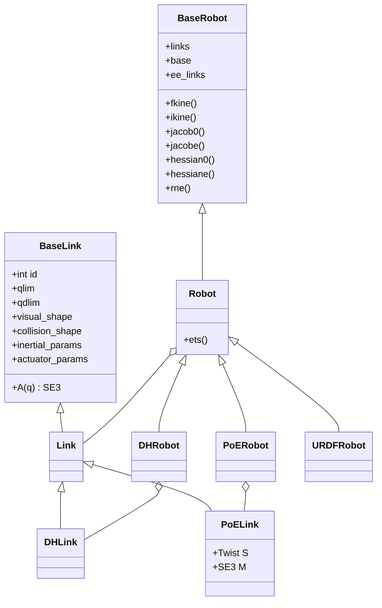
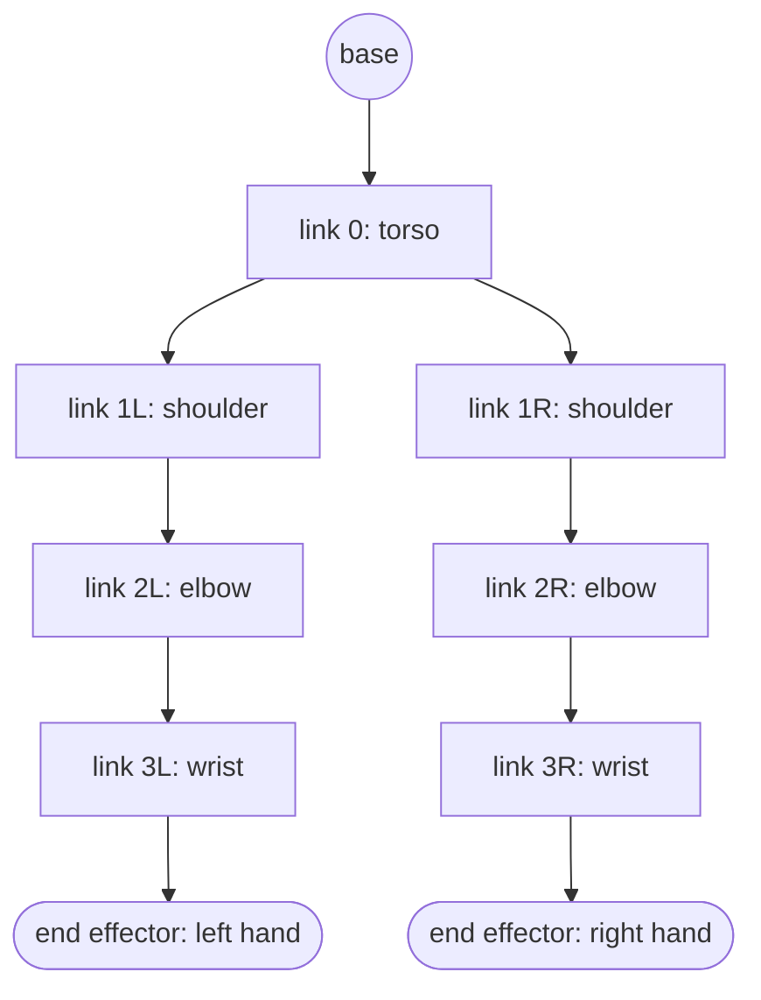
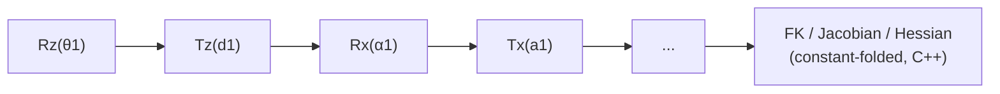

# Desiderata

The foundational concepts and principles of the Robotics Toolbox for Python (RTB-P).

**Purpose.** This document is both aspiration and guidance. It states the design the toolbox should converge on, not necessarily the design it currently has. Where the codebase diverges from a point below, that is drift to correct, not a precedent to preserve. Open questions are marked explicitly rather than silently resolved.

**Status markers.** Where it matters, a point is marked **[done]** (the code does this), **[partial]** (it does this in some cases) or **[aspiration]** (the design to converge on). Unmarked points describe the design and are mostly done. Last checked against the code for release 1.5.0.

**Comments are welcome** on [Discussions](https://github.com/petercorke/robotics-toolbox-python/discussions) and on the Issue for a topic (for example #884 on grippers). Please comment rather than send a pull request for a change to the design.

---

## 1. Links (`BaseLink`)

A link describes a spatial transform (2D or 3D) between two frames.

Common properties (`BaseLink`):

* has a name, and a joint has a joint index (`jindex`) giving its place in the robot's `q` **[partial]**: the earlier idea of a unique sequential integer identifier for every link is not implemented
* the transform may be constant or parameterised by a single joint variable $q$
* implements `A(q)`, returning an `SE3` (or `SE2`) object for the transform at $q$
* the parameterisation is arbitrary: DH parameters, screws, ETs, etc.
* joint value limits
* a shape for rendering: primitive (box, sphere, ...) or mesh
* a shape for collision checking: primitive or mesh
* inertial parameters: mass, CoG, inertia tensor
* actuator parameters: motor inertia, gear ratio, motor friction (viscous + Coulomb), joint velocity limits, joint acceleration limits

### Concrete link classes: `DHLink`, `PoELink`, `Link`

`Link` is the ETS-based class (`ELink` is its older name). `DHLink` and `PoELink` are subclasses of `Link`. All three:

* represent a physical rigid body
* implement `A(q)`, depending on exactly one variable which is the transformation from frame i-1 to frame i.
* support visual mesh and collision-shape attachments
* support local inertial parameters and actuator friction models

### `PoELink` specifics

* parameterised by a screw axis (`Twist`) $S_i$
* stores its home pose $M_i$ and its parent's home pose $M_{i-1}$
* computes $A_i(q_i) = M_{i-1}^{-1}\, e^{S_i q_i}\, M_i$

### Planar (2D) classes

`Link2`, `Robot2`, `ET2` and `ETS2` are the planar counterparts, working with `SE2` and a rotation about $z$ and translations in the plane. Much of what follows applies to both, but the 2D classes do not have every feature of the 3D ones.

---

## 2. Robots (`BaseRobot`)

A robot is a container for links, organised as a directed acyclic graph (DAG):

* a linear graph where nodes are in series (most industrial arms, excluding fingers), or
* a branching tree (e.g. a humanoid)
* each link has zero or one parent, and zero, one, or more children
* each link in the robot has a name that is unique within the robot

A robot:

* has a base transform: pose of the base w.r.t. the world frame
* holds a list of references to its end effectors (`ee_links`, the DAG leaf nodes) — *resolved from the open question in the original draft: end effectors are pointers to leaf links, not separately-stored tool transforms* **[partial]**: a robot also has a `tool` transform, and may carry `Gripper` objects whose links are held outside the link list. How grippers should be modeled is an open question, see #884
* can compute:
  * forward kinematics for any leaf node (end effector)
  * inverse kinematics for a particular end effector (**stretch**: for all simultaneously)
  * Jacobian, w.r.t. an end effector or the world frame
  * Hessian, w.r.t. an end effector or the world frame
  * joint torques for arbitrary joint configuration, velocity and acceleration
  * inertia, Coriolis, and gravity-load matrices, in joint or task space
* can render/animate at varying fidelity via Matplotlib (desktop, Jupyter, JupyterLite) and Swift **[done]**; MeshCat and CoppeliaSim are **[aspiration]** (see #675)

### Design paradigms (aspirational)

* **Symbolic-agnostic** **[partial]**. Mathematical routines accept NumPy floats or SymPy symbols natively, avoiding duplicate code paths. As much as possible, results should be obtainable symbolically. The compiled code is numeric only: the C++ `ik_XX` solvers cannot take SymPy parameters or joint offsets, and the Python `ikine_XX` solvers can.
* **Optimised for speed.** As much as possible, on the numeric path.
* **Pedagogy vs. speed separation.** `DHRobot` and `PoERobot` stay clean, legible implementations for textbook tracing. Performance-critical work is offloaded to the compiled code of the ETS-based `Robot`, through its `ets()`.
* **Stateless over stateful (aspiration, not yet achieved).** Structures should be immutable during runtime loops — no internal state arrays such as a persistent `.q` — with calculations taking explicit vectors and returning explicit outputs, for thread safety. The current codebase does *not* fully satisfy this (e.g. `.q` is retained for teach panels and plotting, and a `Gripper` keeps its own `q`); reconciling that is a roadmap item, not a description of the present state.

---

## 3. ETS — Elementary Transform Sequences

An ETS represents a string of elementary transforms (ETs). It is a standalone kinematics object, independent of any robot.

An ET:

* describes a rotation or translation about/along a canonical axis: Rx, Ry, Rz, Tx, Ty, Tz
* has a single parameter (an angle or a translation) that may be numeric or symbolic, constant or variable
* a variable parameter may have a lower and upper bound, and a positive or negative sign
* a variable parameter may have an offset, so that the value is $\pm q + a$ (as the offset of a DH link), which arises when a constant is merged into a joint **[done]**, but the compiled code does not handle it, so such an ETS is evaluated in Python

An ETS:

* describes a sequence of ETs forming a linear graph
* can be optimised by constant folding, and rearranged without changing what it represents: `merge` combines adjacent terms, `swap` exchanges adjacent terms that commute (or moves one across a constant quarter or half turn), and `replace` re-expresses a term on another axis. Each has a form that returns a copy (`merged`, `swapped`, `replaced`) **[done]**
* can compute:
  * forward kinematics, by evaluating the sequence and substituting variable values into the ETs that have one
  * Jacobian, w.r.t. the initial or final frame
  * Hessian, w.r.t. the initial or final frame
  * inverse kinematics, via numerical optimisation using FK and the Jacobian, in Python (`ikine_XX`) or in C++ (`ik_XX`, with the limits above)
* may use a C++-optimised backend for these computations

**An ETS is not a robot.** It deliberately excludes:

* dynamic parameters
* joint velocity/acceleration limits
* actuator parameters
* the concept of named link frames

This separation matters: ETS is pure kinematic algebra, usable on its own, and it is what makes the ETS-based `Robot` fast — a robot's kinematics can be flattened into one optimisable ETS, stripped of everything a robot needs but an ETS doesn't.

---

## 4. Robot classes and their relationship to ETS

`Robot` is the ETS-based robot class (`ERobot` is its older name). `DHRobot`, `PoERobot`, `ERobot` and `URDFRobot` are subclasses of it, all derived from `BaseRobot`.

| Link class | Robot class | FK | Jacobian | IK | Dynamics | Exports |
|---|---|---|---|---|---|---|
| `DHLink` | `DHRobot` | sequential `.A(q)` chaining | `jacobe` from first principles, transformed for `jacob0` | numerical (`ikine_XX`); analytic for any six-joint arm, `ikine_analytic` | classic textbook RNE (`rne`, `rne_python`) | `.ets()` |
| `PoELink` | `PoERobot` | sequential `.A(q)` chaining | via Adjoint maps | numerical | *(open question)* | `.ets()` |
| `Link` | `Robot` | compiled C++ (Python for an ETS with offsets) | compiled C++ | numerical, `ikine_XX` (Python) or `ik_XX` (C++) | `Robot.rne`, generic ETS-based | — (this *is* the target) |

Inverse dynamics (RNE) has three implementations: `DHRobot.rne` (C, with the pure-Python `rne_python` as the fallback for symbolic values and in the browser), and `Robot.rne` (ETS-based). See the wiki page on dynamics.

The numerical `ikine_XX` methods are in `Robot` (through `RobotKinematicsMixin`) and call the subclass's `fkine` and `jacob0`, so any subclass gets IK "for free" by implementing FK and the Jacobian.

---

## 5. Construction paths

How a user actually builds a robot:

* create a DH table and pass it to `DHRobot`
* create `DHLink` objects and pass them to `DHRobot`
* create a list of screws and a zero-configuration pose, pass to `PoERobot`
* create `PoELink` objects and a zero-configuration pose, pass to `PoERobot`
* create an `ETS`, or `Link` objects, and pass it to `Robot`
* pass a URDF filename to `URDFRobot`, which constructs an ETS-based `Robot`

---

## 6. Not yet covered here

* **Grippers and tools.** How a gripper, or any end-effector subtree, should be modeled: #884.
* **Mobile robots.** The `mobile/` package (vehicles, sensors, planners, estimators) has its own conventions that are not described in this document.
* **Backends.** What a graphical backend must provide is the `Connector` protocol, see the wiki page on backends.

---

## Diagrams

### Class hierarchy

### DAG structure (example: two-armed / humanoid-style robot)

Each link has zero or one parent and zero-or-more children; leaf nodes are end effectors, referenced directly by the robot rather than stored as separate tool transforms.

### ETS pipeline (flattening for the ETS-based `Robot`)

A `DHRobot` or `PoERobot` gives this representation with `.ets()`; the sequence is then constant-folded and evaluated by the compiled backend.
